# BÁO CÁO TIẾN ĐỘ ĐỒ ÁN

## Xây dựng sàn thương mại điện tử nhiều người bán theo kiến trúc microservices

| | |
| --- | --- |
| **Giảng viên hướng dẫn** | *(điền tên)* |
| **Nhóm thực hiện** | *(điền tên thành viên, mã sinh viên)* |
| **Thời điểm báo cáo** | Tháng 10/2026 |
| **Nội dung báo cáo** | Tổng quan nghiệp vụ, thiết kế hệ thống, công nghệ, hạ tầng và tiến độ |

---

## Mục lục

1. Giới thiệu đề tài
2. Phân tích nghiệp vụ
3. Thiết kế hệ thống
4. Công nghệ sử dụng
5. Hạ tầng và triển khai
6. Tiến độ thực hiện
7. Khó khăn, rủi ro và đề xuất

Phụ lục A. Bảng thuật ngữ
Phụ lục B. Danh mục sơ đồ

---

## 1. Giới thiệu đề tài

### 1.1. Bối cảnh

Sàn thương mại điện tử nhiều người bán (marketplace) là mô hình trong đó nhiều cửa hàng độc lập cùng bán hàng trên một nền tảng chung; sàn đứng giữa để quản lý giao dịch, thu tiền, điều phối vận chuyển và giải quyết khiếu nại. Các sàn phổ biến tại Việt Nam như Shopee, Lazada, Tiki đều vận hành theo mô hình này.

Điểm khó của mô hình không nằm ở việc hiển thị sản phẩm hay giỏ hàng, mà ở các nghiệp vụ phía sau: một lần thanh toán chứa hàng của nhiều cửa hàng, mỗi cửa hàng xử lý đơn độc lập, tiền thu của người mua phải được phân bổ đúng cho từng người bán sau khi trừ phí, và mọi tình huống hủy, hoàn tiền, trả hàng đều phải giữ cho số tiền luôn khớp.

### 1.2. Mục tiêu

Đồ án xây dựng một sàn thương mại điện tử nhiều người bán có **đủ vòng đời mua, bán và vận hành**:

- **Người mua:** tìm hàng, đặt hàng của nhiều shop trong một lần, thanh toán trực tuyến hoặc khi nhận hàng, theo dõi đơn, hủy, trả hàng, khiếu nại, đánh giá.
- **Người bán:** mở shop, đăng sản phẩm, quản lý tồn kho, xử lý và giao đơn, xử lý trả hàng, theo dõi doanh thu và rút tiền.
- **Quản trị viên:** duyệt shop, kiểm duyệt vi phạm, kiểm tra đơn có rủi ro, phân xử tranh chấp, đối soát tiền, duyệt rút tiền, cấu hình chính sách.

Về mặt kỹ thuật, đồ án hướng tới một hệ thống chia thành nhiều dịch vụ độc lập (microservices), tích hợp đối tác thanh toán và vận chuyển thật ở môi trường thử nghiệm, và triển khai được trên Kubernetes.

### 1.3. Phạm vi

**Trong phạm vi:**

| Nhóm | Nội dung |
| --- | --- |
| Tài khoản và cửa hàng | Đăng ký, đăng nhập (email hoặc Google), hồ sơ, sổ địa chỉ; mở shop có duyệt; đình chỉ shop vi phạm |
| Sản phẩm | Danh mục 2 cấp, sản phẩm có phân loại (màu, dung lượng…), tồn kho theo từng phân loại, tìm kiếm có dấu/không dấu |
| Mua hàng | Giỏ hàng nhiều shop, voucher của shop và của sàn, đặt hàng nhiều shop một lần |
| Thanh toán | Trả trước qua VNPay, thanh toán khi nhận hàng (COD), hoàn tiền |
| Vận chuyển | Tính phí, tạo vận đơn, theo dõi giao hàng qua GHN; giao thất bại, hoàn kiện |
| Hậu mãi | Hủy đơn, trả hàng, hoàn tiền một phần, khiếu nại và phân xử |
| Tài chính người bán | Phí sàn, ví người bán, đối soát, yêu cầu rút tiền, chi trả có chứng từ |
| Tương tác | Đánh giá sản phẩm, theo dõi shop, chat người mua – người bán, thông báo |
| Quản trị | Phân quyền quản trị viên, nhật ký thao tác, cấu hình chính sách, báo cáo |

**Ngoài phạm vi** (để dành cho hướng phát triển): chatbot tư vấn, gợi ý sản phẩm bằng học máy, flash sale và khuyến mãi phức tạp, livestream bán hàng, nhiều đơn vị vận chuyển, kho và đội giao hàng riêng của sàn. Lý do: các phần này không thuộc vòng đời giao dịch cốt lõi, trong khi khối lượng nghiệp vụ cốt lõi đã đủ lớn cho thời lượng đồ án.

### 1.4. Đối tượng sử dụng

| Đối tượng | Mô tả |
| --- | --- |
| Khách vãng lai | Chưa đăng nhập; xem và tìm kiếm sản phẩm |
| Người mua | Đã đăng nhập; mua hàng, theo dõi đơn, hậu mãi |
| Người bán | Người mua có shop đã được duyệt. Mỗi tài khoản có tối đa một shop; một người vừa mua vừa bán được |
| Quản trị viên | Được cấp một hoặc nhiều bộ quyền: Kiểm duyệt, Hỗ trợ, Tài chính/rủi ro, Hệ thống |
| Đối tác | VNPay (cổng thanh toán), GHN (vận chuyển), Google (đăng nhập) |

---

## 2. Phân tích nghiệp vụ

### 2.1. Tác nhân và phân quyền

Quản trị viên không dùng chung một quyền mà được chia theo bộ quyền, để phân công công việc và tránh một người nắm toàn bộ thao tác nhạy cảm:

| Bộ quyền | Trách nhiệm |
| --- | --- |
| Kiểm duyệt | Duyệt hồ sơ mở shop, quản lý danh mục, đình chỉ/khôi phục shop, xử lý báo cáo vi phạm |
| Hỗ trợ | Tra cứu đơn hàng, hủy đơn khi được người dùng nhờ, xem hồ sơ trả hàng |
| Tài chính/rủi ro | Duyệt đơn có rủi ro, hoàn tiền thủ công, đối soát, duyệt rút tiền, quản lý voucher của sàn |
| Hệ thống | Cấp/thu hồi quyền quản trị, cấu hình chính sách, xem nhật ký thao tác |

Hai nguyên tắc chung:

- **Không tự duyệt việc của mình:** quản trị viên đồng thời là chủ shop hoặc là người mua của đơn thì không được duyệt hồ sơ, đơn hàng hay khiếu nại liên quan.
- **Mọi thao tác của quản trị viên đều được ghi nhật ký:** ai làm, lúc nào, đối tượng nào, lý do gì.

### 2.2. Mô hình use case

#### 2.2.1. Sơ đồ use case tổng quát

Sơ đồ tổng quát thể hiện các nhóm chức năng lớn của sàn và tác nhân sử dụng từng nhóm. Người mua kế thừa mọi chức năng của khách vãng lai; người bán kế thừa mọi chức năng của người mua (một tài khoản vừa mua vừa bán được). VNPay và GHN là tác nhân bên ngoài tham gia vào thanh toán, vận chuyển và đối soát; "Hệ thống" đại diện cho các việc tự động chạy theo thời hạn.

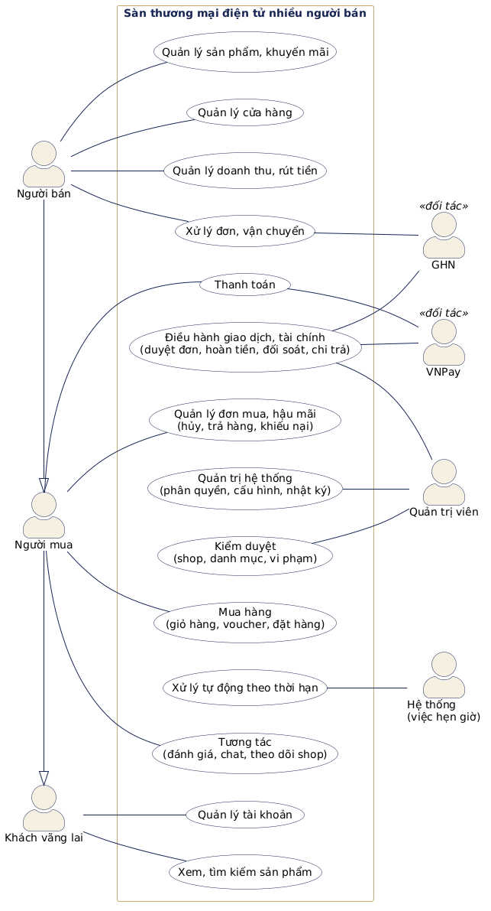

#### 2.2.2. Sơ đồ use case phân rã

**a) Khách vãng lai và người mua**

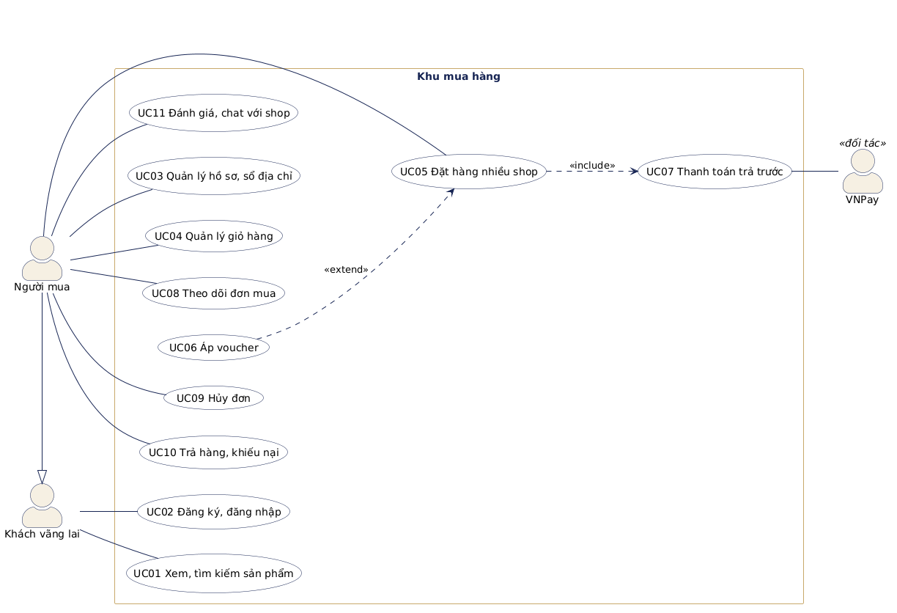

Đặt hàng nhiều shop (UC05) luôn bao gồm bước thanh toán (UC07, quan hệ *include*); áp voucher (UC06) là bước tùy chọn mở rộng của đặt hàng (quan hệ *extend*).

**b) Người bán**

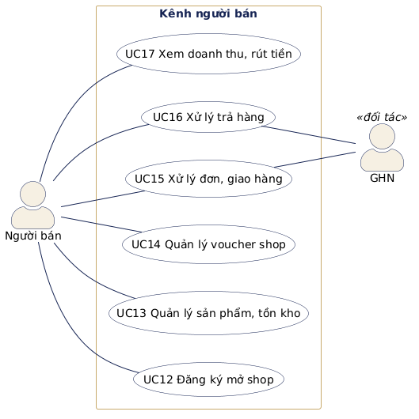

**c) Quản trị viên và hệ thống**

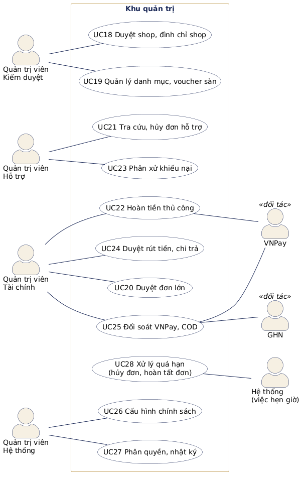

Quản trị viên được tách theo bộ quyền để thể hiện rõ ai chịu trách nhiệm use case nào. Một tài khoản quản trị có thể được cấp nhiều bộ quyền.

#### 2.2.3. Danh sách use case

| Mã | Use case | Tác nhân | Mô tả ngắn | Giai đoạn |
| --- | --- | --- | --- | --- |
| UC01 | Xem, tìm kiếm sản phẩm | Khách vãng lai | Xem trang chủ, danh mục, trang sản phẩm, trang shop; tìm theo từ khóa, lọc theo danh mục và giá | P2 |
| UC02 | Đăng ký, đăng nhập | Khách vãng lai | Đăng ký có xác minh email; đăng nhập bằng email hoặc Google; quên mật khẩu | P1 |
| UC03 | Quản lý hồ sơ, sổ địa chỉ | Người mua | Sửa thông tin cá nhân, đổi mật khẩu, quản lý tối đa 10 địa chỉ nhận hàng | P1 |
| UC04 | Quản lý giỏ hàng | Người mua | Thêm, sửa số lượng, đổi phân loại, chọn, xóa sản phẩm trong giỏ nhiều shop | P2 |
| UC05 | Đặt hàng nhiều shop | Người mua | Xem trước đơn, chọn địa chỉ, đặt hàng; hệ thống tách đơn theo shop | P3 |
| UC06 | Áp voucher | Người mua | Chọn voucher của từng shop và voucher của sàn khi đặt hàng | P3 |
| UC07 | Thanh toán trả trước | Người mua, VNPay | Thanh toán đơn qua VNPay trong thời hạn, được thử lại khi thất bại | P3 |
| UC08 | Theo dõi đơn mua | Người mua | Xem danh sách, chi tiết, trạng thái và lịch sử của từng đơn con | P3 |
| UC09 | Hủy đơn | Người mua | Hủy đơn hoặc gửi yêu cầu hủy theo trạng thái đơn; nhận hoàn tiền | P3 |
| UC10 | Trả hàng, khiếu nại | Người mua | Yêu cầu trả hàng trong 7 ngày sau khi nhận; khiếu nại khi shop từ chối | P5 |
| UC11 | Đánh giá, chat với shop | Người mua | Đánh giá sản phẩm đã mua, theo dõi shop, nhắn tin với shop | P6 |
| UC12 | Đăng ký mở shop | Người mua | Nộp hồ sơ mở shop, sửa và nộp lại khi bị từ chối | P1 |
| UC13 | Quản lý sản phẩm, tồn kho | Người bán | Đăng, sửa, ẩn sản phẩm có phân loại; nhập, điều chỉnh tồn kho có lịch sử | P2 |
| UC14 | Quản lý voucher shop | Người bán | Tạo, sửa, kết thúc voucher của shop | P2 |
| UC15 | Xử lý đơn, giao hàng | Người bán, GHN | Xác nhận hoặc hủy đơn; trả lời yêu cầu hủy; tạo vận đơn, bàn giao, theo dõi giao hàng | P3–P4 |
| UC16 | Xử lý trả hàng | Người bán, GHN | Chấp nhận hoặc từ chối yêu cầu trả hàng; nhận và kiểm hàng hoàn | P5 |
| UC17 | Xem doanh thu, rút tiền | Người bán | Xem tiền từng đơn, số dư ví; gửi yêu cầu rút tiền | P4–P5 |
| UC18 | Duyệt shop, đình chỉ shop | QTV Kiểm duyệt | Duyệt hoặc từ chối hồ sơ mở shop; đình chỉ, khôi phục shop vi phạm | P1–P2 |
| UC19 | Quản lý danh mục, voucher sàn | QTV Kiểm duyệt, Tài chính | Quản lý cây danh mục; tạo voucher do sàn chịu | P2 |
| UC20 | Duyệt đơn lớn | QTV Tài chính | Xem đơn chạm luật kiểm tra, duyệt hoặc từ chối trong 24 giờ | P3 |
| UC21 | Tra cứu, hủy đơn hỗ trợ | QTV Hỗ trợ | Tra cứu mọi đơn theo mã, hủy đơn có lý do khi được nhờ | P3 |
| UC22 | Hoàn tiền thủ công | QTV Tài chính, VNPay | Xử lý khoản hoàn tự động thất bại: chuyển khoản tay, nhập chứng từ | P3 |
| UC23 | Phân xử khiếu nại | QTV Hỗ trợ | Xem trình bày và bằng chứng của hai bên, ra quyết định | P5 |
| UC24 | Duyệt rút tiền, chi trả | QTV Tài chính | Duyệt yêu cầu rút tiền, chuyển khoản và nhập chứng từ | P5 |
| UC25 | Đối soát VNPay, COD | QTV Tài chính, VNPay, GHN | Đối chiếu giao dịch VNPay; tải file đối soát COD của GHN, xử lý dòng lệch | P4 |
| UC26 | Cấu hình chính sách | QTV Hệ thống | Thay đổi thời hạn, phí, ngưỡng; mỗi lần đổi là một phiên bản mới | P3 |
| UC27 | Phân quyền, nhật ký | QTV Hệ thống | Cấp/thu hồi bộ quyền quản trị, khóa tài khoản, xem nhật ký thao tác | P1 |
| UC28 | Xử lý quá hạn | Hệ thống | Hủy đơn quá hạn thanh toán/xác nhận/duyệt; hoàn tất đơn sau 7 ngày | P3–P4 |

*QTV: quản trị viên.*

Bảng dưới đây tóm tắt phạm vi chức năng theo nhóm nghiệp vụ (tương ứng với bản đồ chức năng, sơ đồ 01 trong Phụ lục B):

| Nhóm | Chức năng chính | Người dùng |
| --- | --- | --- |
| Tài khoản | Đăng ký và xác minh email; đăng nhập bằng email hoặc Google; quên/đổi mật khẩu; hồ sơ; sổ địa chỉ (tối đa 10 địa chỉ) | Mọi người dùng |
| Cửa hàng | Nộp hồ sơ mở shop; duyệt/từ chối; sửa hồ sơ (đổi tên shop, tài khoản ngân hàng phải duyệt lại); đình chỉ/khôi phục | Người bán, Kiểm duyệt |
| Sản phẩm | Danh mục 2 cấp; đăng, sửa, ẩn sản phẩm; tối đa 2 nhóm phân loại × 10 lựa chọn; ảnh theo màu; nhập và điều chỉnh tồn kho có lịch sử | Người bán, Kiểm duyệt |
| Tìm kiếm | Tìm theo từ khóa (gõ có dấu hay không dấu đều ra), lọc theo danh mục, giá; sắp xếp | Mọi người |
| Giỏ hàng, voucher | Giỏ hàng nhiều shop; voucher giảm tiền hoặc giảm % có mức trần; voucher của shop (shop chịu) và của sàn (sàn chịu) | Người mua, Người bán, Tài chính |
| Đặt hàng | Đặt hàng nhiều shop một lần; tách đơn theo shop; tính phí vận chuyển; áp voucher | Người mua |
| Thanh toán | Trả trước qua VNPay; thanh toán khi nhận hàng (COD); hoàn tiền tự động và thủ công | Người mua, Tài chính |
| Kiểm tra đơn | Đơn giá trị lớn phải được quản trị viên duyệt trước khi shop xử lý | Hệ thống, Tài chính |
| Xử lý đơn | Shop xác nhận, tạo vận đơn, bàn giao cho GHN; theo dõi giao hàng; hủy đơn | Người bán, Người mua |
| Hậu mãi | Trả hàng, hoàn tiền một phần, khiếu nại, phân xử | Người mua, Người bán, Hỗ trợ |
| Tài chính người bán | Ví người bán; tiền đang giữ/khả dụng/đang khóa; yêu cầu rút tiền; chi trả có chứng từ; đối soát COD và VNPay | Người bán, Tài chính |
| Tương tác | Đánh giá sản phẩm, phản hồi đánh giá, theo dõi shop, thả tim sản phẩm, chat, thông báo | Người mua, Người bán |
| Quản trị | Phân quyền; nhật ký thao tác; cấu hình chính sách; báo cáo vận hành và tài chính | Quản trị viên |

### 2.3. Đặc tả các use case chính

Phần này đặc tả bốn use case quan trọng nhất của giai đoạn hiện tại. Các use case còn lại sẽ được đặc tả theo từng giai đoạn triển khai.

#### 2.3.1. UC05 – Đặt hàng nhiều shop

| Mục | Nội dung |
| --- | --- |
| **Tác nhân chính** | Người mua |
| **Tác nhân phụ** | Không |
| **Mô tả** | Người mua đặt các sản phẩm đã chọn trong giỏ, thuộc một hoặc nhiều shop, trong một lần. Hệ thống tạo một đơn tổng và một đơn con cho mỗi shop. |
| **Điều kiện trước** | Người mua đã đăng nhập; giỏ hàng có ít nhất một sản phẩm đang được chọn; sổ địa chỉ có ít nhất một địa chỉ. |
| **Điều kiện sau** | Đơn tổng và các đơn con được tạo ở trạng thái "Chờ thanh toán"; tồn kho và lượt voucher được giữ; các sản phẩm đã đặt được xóa khỏi giỏ. |
| **Luồng chính** | 1. Người mua chọn sản phẩm trong giỏ và bấm "Mua hàng".<br>2. Hệ thống hiển thị bản xem trước: địa chỉ mặc định; sản phẩm, phí vận chuyển và voucher dùng được của từng shop; voucher của sàn; tổng tiền. Hệ thống tự áp voucher giảm nhiều nhất.<br>3. Người mua có thể đổi địa chỉ nhận hàng hoặc đổi voucher (UC06); hệ thống tính lại bản xem trước.<br>4. Người mua bấm "Đặt hàng".<br>5. Hệ thống kiểm tra lại toàn bộ đơn; giữ tồn kho, giữ lượt voucher; tạo đơn tổng và các đơn con.<br>6. Hệ thống chuyển người mua sang bước thanh toán (UC07). |
| **Luồng thay thế** | 2a. Có sản phẩm hết hàng, ngừng bán hoặc vượt tồn: hệ thống liệt kê sản phẩm có vấn đề, không cho đặt hàng cho tới khi người mua sửa giỏ.<br>2b. Người mua chưa có địa chỉ: hệ thống yêu cầu thêm địa chỉ trước.<br>3a. Mã voucher không hợp lệ hoặc chưa đủ điều kiện: hệ thống báo lý do (ví dụ "Mua thêm 50.000đ để dùng mã này"), không áp mã, phần còn lại của đơn vẫn hợp lệ.<br>5a. Giá, tồn kho hoặc voucher thay đổi so với bản xem trước: hệ thống không tạo đơn nào, báo cụ thể thay đổi và hiển thị lại bản xem trước mới.<br>5b. Người mua bấm "Đặt hàng" nhiều lần hoặc gửi lại do mạng chập chờn: hệ thống trả về đúng đơn đã tạo, không tạo đơn mới. |
| **Quy tắc liên quan** | Mỗi đơn con tối đa một voucher của shop; cả đơn tổng tối đa một voucher của sàn. Voucher sàn chia theo tỉ lệ tiền hàng của từng đơn con. Lỗi ở một shop thì không tạo đơn nào. Hạn thanh toán 15 phút, giữ tồn kho 20 phút. |

#### 2.3.2. UC07 – Thanh toán trả trước

| Mục | Nội dung |
| --- | --- |
| **Tác nhân chính** | Người mua |
| **Tác nhân phụ** | VNPay |
| **Mô tả** | Người mua thanh toán đơn tổng qua cổng VNPay. Sàn chỉ ghi nhận đã thanh toán khi có xác nhận hợp lệ từ VNPay. |
| **Điều kiện trước** | Đơn tổng ở trạng thái chưa thanh toán, chưa bị hủy và còn trong hạn thanh toán; số lần thanh toán chưa vượt giới hạn. |
| **Điều kiện sau** | Thành công: đơn được ghi nhận đã thanh toán, tồn kho được trừ hẳn, tiền được phân bổ cho từng đơn con; nếu đơn đã qua kiểm tra thì các đơn con chuyển sang "Chờ shop xác nhận". Thất bại: người mua được thử lại trong hạn. |
| **Luồng chính** | 1. Người mua bấm "Thanh toán".<br>2. Hệ thống tạo một lần thanh toán với mã giao dịch riêng và chuyển người mua sang trang VNPay.<br>3. Người mua nhập thông tin và xác nhận thanh toán trên VNPay.<br>4. VNPay gửi kết quả trực tiếp tới máy chủ của sàn; hệ thống kiểm tra chữ ký, mã giao dịch và số tiền rồi ghi nhận đã thanh toán.<br>5. VNPay đưa người mua về trang kết quả; trang hiển thị trạng thái thật của đơn do máy chủ xác nhận. |
| **Luồng thay thế** | 3a. Người mua hủy giao dịch hoặc thanh toán thất bại: lần thanh toán được ghi thất bại; người mua được thử lại, tối đa 3 lần trong hạn.<br>3b. Người mua đóng trang VNPay giữa chừng rồi bấm thanh toán lại: hệ thống mở lại đúng giao dịch đang chờ, không tính thêm lần.<br>4a. Sàn không nhận được kết quả từ VNPay: khi người mua quay về, hệ thống tra cứu VNPay để xác định kết quả; nếu vẫn chưa rõ thì đánh dấu "chưa rõ", không cho tạo lần mới và tiếp tục tra cứu định kỳ.<br>4b. Hết hạn mà không có tiền, hoặc đã thất bại đủ 3 lần: đơn bị hủy, tồn kho và lượt voucher được trả lại.<br>4c. Tiền về sau khi đơn đã hết hạn hoặc bị hủy: hệ thống ghi nhận tiền và tự tạo lệnh hoàn cho người mua. |
| **Quy tắc liên quan** | Không coi trang báo thành công phía người mua là bằng chứng thanh toán. Kết quả VNPay gửi trùng chỉ được ghi nhận một lần. Phí cổng thanh toán khi hoàn tiền do sàn chịu. |

#### 2.3.3. UC09 – Hủy đơn

| Mục | Nội dung |
| --- | --- |
| **Tác nhân chính** | Người mua |
| **Tác nhân phụ** | Người bán (khi trả lời yêu cầu hủy), VNPay (hoàn tiền) |
| **Mô tả** | Người mua hủy đơn trước khi hàng được bàn giao cho đơn vị vận chuyển. Cách hủy phụ thuộc trạng thái đơn. |
| **Điều kiện trước** | Người mua là chủ đơn; đơn chưa được bàn giao cho đơn vị vận chuyển. |
| **Điều kiện sau** | Đơn con bị hủy, ghi rõ người hủy và lý do; tồn kho được cộng lại; voucher được trả lượt theo quy tắc; nếu đã thanh toán thì khoản hoàn được tạo. Các đơn con khác không bị ảnh hưởng. |
| **Luồng chính** | 1. Người mua mở chi tiết đơn và chọn hủy.<br>2. Người mua chọn lý do có sẵn hoặc tự nhập lý do.<br>3. Hệ thống xử lý theo trạng thái:<br>– Đơn chưa thanh toán: hủy cả đơn tổng, nhả tồn kho, trả lượt mọi voucher.<br>– Đã thanh toán, shop chưa xác nhận: hủy ngay đơn con của shop đó.<br>4. Với đơn đã thanh toán, hệ thống gửi lệnh hoàn số tiền người mua đã trả cho đơn con đó qua VNPay.<br>5. Người mua theo dõi trạng thái hoàn tiền trên chi tiết đơn. |
| **Luồng thay thế** | 3a. Shop đã xác nhận đơn: người mua gửi yêu cầu hủy (mỗi đơn con một lần); đơn chuyển sang "Đang xin hủy". Shop đồng ý thì đơn bị hủy và hoàn tiền; shop từ chối thì đơn quay lại "Chờ giao hàng".<br>3b. Đơn đã bàn giao cho đơn vị vận chuyển: không hủy được, người mua dùng chức năng trả hàng sau khi nhận (UC10).<br>4a. Hoàn tiền tự động thất bại: hệ thống thử lại tối đa 3 lần theo lịch; vẫn lỗi thì chuyển quản trị viên Tài chính hoàn thủ công (UC22). |
| **Quy tắc liên quan** | Đơn chưa thanh toán chỉ hủy được cả đơn tổng. Voucher của shop được trả khi đơn con của shop đó bị hủy; voucher của sàn chỉ được trả khi cả đơn tổng bị hủy; voucher đã hết hạn thì không trả. Hủy và việc đơn vị vận chuyển lấy hàng chỉ một bên được chấp nhận. |

#### 2.3.4. UC20 – Duyệt đơn lớn

| Mục | Nội dung |
| --- | --- |
| **Tác nhân chính** | Quản trị viên Tài chính/rủi ro |
| **Tác nhân phụ** | Hệ thống (tự hủy khi quá hạn) |
| **Mô tả** | Đơn chạm luật kiểm tra rủi ro phải được quản trị viên duyệt trước khi shop được xử lý. Việc kiểm tra chạy song song với thanh toán. |
| **Điều kiện trước** | Đơn tổng vừa được tạo và chạm ít nhất một luật: tổng tiền từ 10.000.000đ, hoặc đơn COD từ 3.000.000đ. |
| **Điều kiện sau** | Duyệt: đơn được đánh dấu đã qua kiểm tra; nếu đã thanh toán thì các đơn con chuyển sang "Chờ shop xác nhận". Từ chối hoặc quá hạn: mọi đơn con bị hủy, người mua được hoàn tiền nếu đã trả. |
| **Luồng chính** | 1. Quản trị viên mở danh sách đơn chờ duyệt (đơn chờ lâu nhất lên đầu, kèm thời gian còn lại).<br>2. Quản trị viên xem chi tiết: luật đã chạm, các shop và sản phẩm trong đơn, tỉnh nhận hàng, lịch sử mua của người mua (số đơn trước đó, tổng tiền, số đơn bị từ chối).<br>3. Quản trị viên chọn "Duyệt".<br>4. Hệ thống ghi quyết định, người duyệt, thời điểm, ghi nhật ký và thông báo cho phần đơn hàng. |
| **Luồng thay thế** | 3a. Quản trị viên chọn "Từ chối" và bắt buộc nhập lý do; mọi đơn con bị hủy, người mua được hoàn tiền nếu đã thanh toán.<br>3b. Quản trị viên là người mua hoặc chủ một shop trong đơn: hệ thống không cho phép quyết định.<br>3c. Hai quản trị viên quyết định cùng lúc: chỉ quyết định đầu tiên có hiệu lực, người sau được báo "đã được xử lý".<br>4a. Quá 24 giờ chưa có quyết định: hệ thống tự hủy đơn (không bao giờ tự duyệt).<br>4b. Người mua tự hủy đơn trong lúc chờ duyệt: hồ sơ được đóng, quản trị viên không phải xử lý. |
| **Quy tắc liên quan** | Ngưỡng duyệt và thời hạn duyệt là cấu hình có phiên bản; đơn được kiểm tra theo ngưỡng tại thời điểm đặt. Mọi quyết định đều được ghi nhật ký. |

### 2.4. Các luồng nghiệp vụ chính

#### 2.4.1. Đăng ký tài khoản và mở cửa hàng

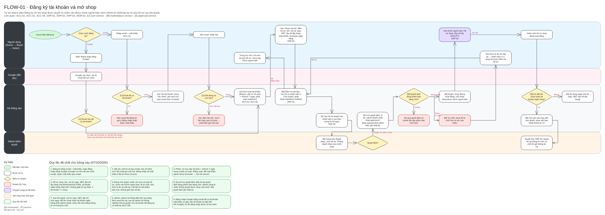

1. Khách đăng ký bằng họ tên, email, mật khẩu, rồi nhập mã xác minh 6 số gửi qua email (hiệu lực 10 phút). Có thể đăng nhập bằng Google; nếu email Google đã có tài khoản thì hai cách đăng nhập được gộp làm một.
2. Người dùng nộp hồ sơ mở shop: tên, mô tả, logo, số điện thoại, địa chỉ lấy hàng, tài khoản ngân hàng nhận tiền.
3. Quản trị viên Kiểm duyệt duyệt hoặc từ chối (bắt buộc ghi lý do khi từ chối).
4. Bị từ chối thì người dùng sửa và nộp lại thành phiên bản mới, không giới hạn số lần. Được duyệt thì vào được Kênh người bán.
5. Sau khi hoạt động, shop sửa mô tả, logo, địa chỉ thì áp dụng ngay; đổi tên shop hoặc tài khoản ngân hàng thì phải duyệt lại, trong lúc chờ shop vẫn bán bằng thông tin cũ.

#### 2.4.2. Đặt hàng nhiều cửa hàng trong một lần

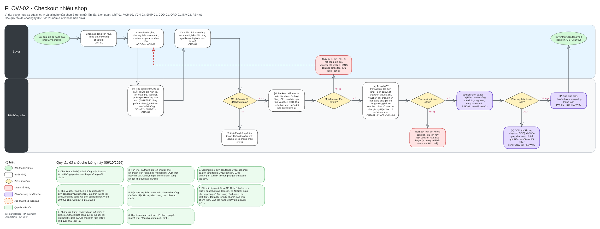

1. Người mua chọn các sản phẩm trong giỏ (có thể thuộc nhiều shop) và bấm Mua hàng.
2. Hệ thống tạo **bản xem trước**: giá hiện tại, phí vận chuyển của từng shop, voucher dùng được và tổng tiền tách theo shop. Bản xem trước có một mã phiên để chống đặt trùng.
3. Người mua chọn địa chỉ nhận, voucher của từng shop, voucher của sàn, rồi bấm Đặt hàng.
4. Hệ thống kiểm tra lại toàn bộ trong một giao dịch duy nhất: hàng còn bán, còn đủ tồn, giá không đổi, voucher còn lượt. Nếu hợp lệ thì tạo **một đơn tổng** và **một đơn con cho mỗi shop**, giữ tồn kho và lượt voucher.
5. **Toàn bộ hoặc không:** chỉ cần một shop có lỗi (hết hàng, đổi giá, voucher hết lượt) thì không tạo đơn nào; người mua thấy lý do cụ thể và xem lại đơn.
6. Bấm Đặt hàng hai lần, hoặc mạng chập chờn gửi lại, chỉ tạo đúng một đơn.

#### 2.4.3. Thanh toán trả trước và kiểm tra đơn

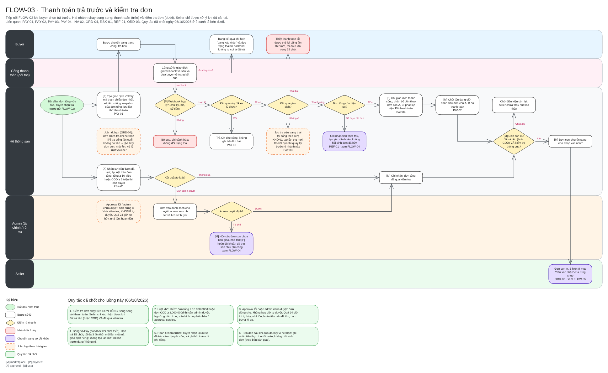

Sau khi đặt hàng, hai việc chạy song song:

**Thanh toán:**

1. Người mua được chuyển sang cổng VNPay, có 15 phút để thanh toán, tối đa 3 lần thử; mỗi lần thử là một giao dịch riêng.
2. Hệ thống chỉ ghi nhận "đã thanh toán" khi VNPay xác nhận trực tiếp với máy chủ của sàn (có chữ ký số và đúng số tiền), hoặc khi tra cứu VNPay cho kết quả thành công. Trang báo thành công phía người mua không được coi là bằng chứng.
3. Quá hạn mà không có tiền thì đơn tự hủy, trả lại tồn kho và lượt voucher.

**Kiểm tra đơn:**

1. Hệ thống áp luật kiểm tra trên đơn tổng: đơn từ 10.000.000đ, hoặc đơn COD từ 3.000.000đ, phải được quản trị viên Tài chính duyệt.
2. Đơn không chạm luật được thông qua ngay.
3. Hệ thống **không bao giờ tự duyệt**: quá 24 giờ chưa có quyết định thì đơn tự hủy và người mua được hoàn tiền nếu đã trả.

Chỉ khi đơn **đã được thanh toán và đã qua kiểm tra**, các đơn con mới chuyển sang shop xác nhận.

#### 2.4.4. Xử lý đơn và giao hàng

1. Shop xác nhận đơn trong vòng 24 giờ, sau đó tạo vận đơn GHN và bàn giao hàng trong vòng 48 giờ. Quá hạn thì đơn tự hủy và người mua được hoàn tiền.
2. Trạng thái giao hàng được GHN báo về: đã lấy hàng, đang giao, đã giao, giao thất bại.
3. Giao thất bại thì GHN giao lại theo chính sách của họ; thất bại lần cuối thì hàng được hoàn về shop, shop xác nhận đã nhận và quyết định có nhập lại kho hay không.
4. Đơn hoàn tất sau **7 ngày** kể từ khi giao thành công, hoặc sớm hơn nếu người mua bấm "Đã nhận, không trả hàng". 7 ngày này cũng là hạn yêu cầu trả hàng.

#### 2.4.5. Hủy đơn và hoàn tiền

| Thời điểm | Ai được hủy | Cách xử lý |
| --- | --- | --- |
| Chưa thanh toán | Người mua, quản trị viên | Hủy cả đơn tổng; trả tồn kho và mọi voucher |
| Đã thanh toán, shop chưa xác nhận | Người mua, shop, quản trị viên | Hủy riêng đơn của shop đó, hoàn tiền phần đơn đó |
| Shop đã xác nhận, chưa bàn giao | Người mua gửi yêu cầu (shop đồng ý mới hủy); shop hủy có lý do; quản trị viên | Như trên |
| Đã bàn giao cho GHN | Không hủy được | Chuyển sang luồng trả hàng sau khi nhận |

Khi hủy một đơn con, các đơn con của shop khác không bị ảnh hưởng. Voucher của shop được trả lượt; voucher của sàn chỉ được trả khi cả đơn tổng bị hủy; voucher đã hết hạn thì không trả.

Hoàn tiền được gửi tự động qua cổng thanh toán. Lỗi thì hệ thống thử lại tối đa 3 lần theo lịch; vẫn lỗi thì quản trị viên Tài chính chuyển khoản thủ công cho người mua và nhập mã giao dịch kèm ảnh biên lai.

#### 2.4.6. Trả hàng và khiếu nại

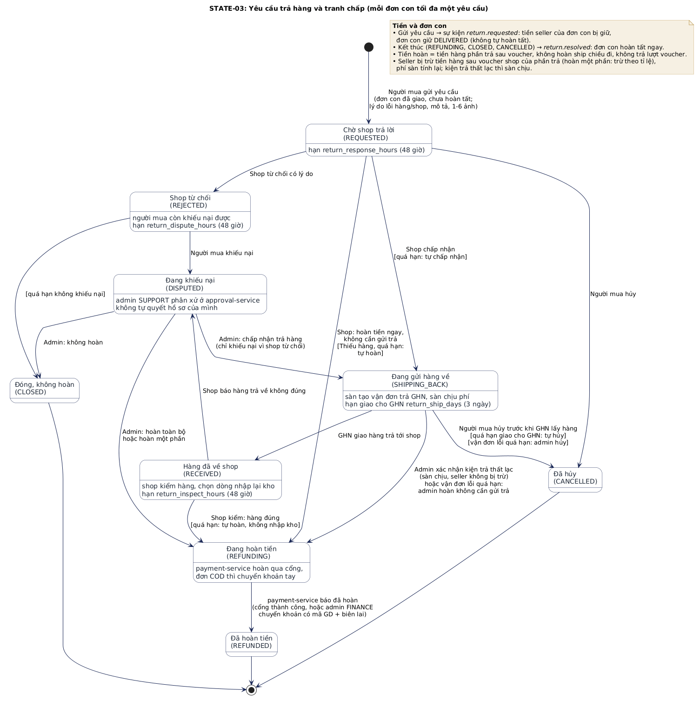

1. Trong 7 ngày sau khi nhận hàng, người mua gửi yêu cầu trả hàng: chọn sản phẩm, số lượng, lý do, mô tả và 1–6 ảnh bằng chứng. Chỉ nhận lý do do lỗi hàng hoặc lỗi shop (hàng lỗi, hư hỏng, giao sai, thiếu hàng, không đúng mô tả, hàng giả), không nhận "đổi ý".
2. Shop chấp nhận hoặc từ chối có lý do trong 48 giờ; quá hạn thì hệ thống tự chấp nhận. Shop có thể chọn "hoàn tiền ngay, không cần gửi trả" (thiếu hàng, hàng rẻ).
3. Chấp nhận trả hàng thì sàn tạo vận đơn GHN chiều về và chịu phí; người mua giao hàng cho GHN trong 3 ngày. Hàng về, shop kiểm trong 48 giờ (quá hạn thì tự hoàn tiền) và chọn món nào được nhập lại kho.
4. Shop từ chối thì người mua khiếu nại trong 48 giờ; hàng trả về không đúng thì shop khiếu nại. Quản trị viên Hỗ trợ phân xử: chấp nhận trả hàng, hoàn toàn bộ, hoàn một phần hoặc không hoàn. Hệ thống không bao giờ tự phân xử.
5. Tiền hoàn là tiền hàng của phần trả sau voucher, không hoàn phí ship chiều đi. Người bán bị trừ phần tiền hàng tương ứng và phí sàn được tính lại trên phần còn lại. Đơn COD được hoàn bằng chuyển khoản thủ công.
6. Trong thời gian có yêu cầu trả hàng hoặc khiếu nại đang mở, tiền của đơn đó bị giữ lại, chưa chuyển cho người bán.

#### 2.4.7. Tiền của người bán và rút tiền

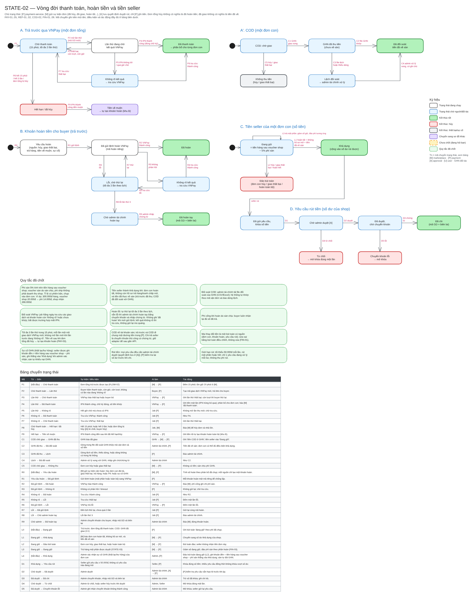

1. Mọi khoản tiền người mua trả (kể cả COD) đều về tài khoản của sàn.
2. Với mỗi đơn con, người bán nhận: **tiền hàng sau voucher của shop, trừ 5% phí sàn**. Voucher của sàn do sàn chịu; phí vận chuyển không tính vào doanh thu của shop.
   Ví dụ: tiền hàng 300.000đ, voucher shop 20.000đ → phí sàn 14.000đ → shop nhận 266.000đ.
3. Ví người bán có ba ngăn: **đang giữ** (đơn chưa hoàn tất), **khả dụng** (rút được), **đang khóa** (đang chờ rút).
4. Tiền chuyển từ "đang giữ" sang "khả dụng" khi đủ cả ba điều kiện: đơn đã hoàn tất, không còn trả hàng/khiếu nại đang mở, và tiền đã thực sự về sàn (với COD là đã đối soát với GHN).
5. Người bán yêu cầu rút tối thiểu 50.000đ, mỗi lúc chỉ một yêu cầu đang xử lý, không thu phí. Mọi yêu cầu đều do quản trị viên Tài chính duyệt; sau khi chuyển khoản, quản trị viên nhập mã giao dịch và ảnh biên lai.

### 2.5. Vòng đời trạng thái của đơn hàng

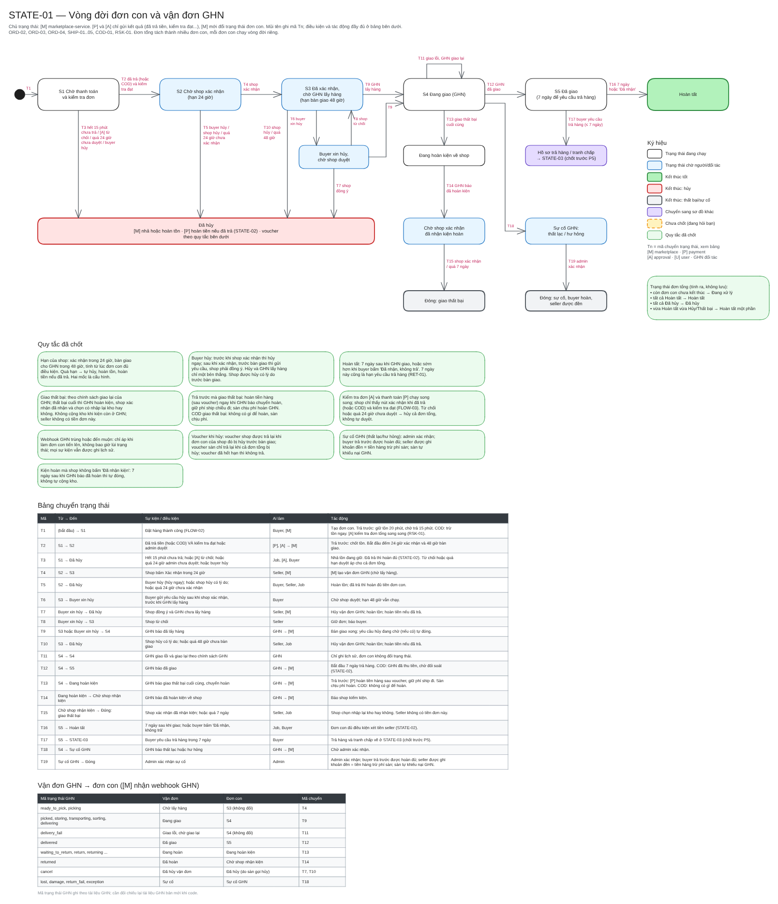

Mỗi đơn con có vòng đời riêng:

| Trạng thái | Ý nghĩa |
| --- | --- |
| Chờ thanh toán / chờ kiểm tra | Đơn mới đặt, chưa trả tiền hoặc chưa qua kiểm tra đơn |
| Chờ shop xác nhận | Đã trả tiền và qua kiểm tra; shop có 24 giờ để xác nhận |
| Chờ giao hàng | Shop đã xác nhận, chuẩn bị bàn giao cho GHN (hạn 48 giờ) |
| Đang xin hủy | Người mua xin hủy sau khi shop xác nhận, chờ shop trả lời |
| Đang giao | GHN đã lấy hàng |
| Đã giao | GHN giao thành công; bắt đầu 7 ngày yêu cầu trả hàng |
| Hoàn tất | Hết 7 ngày hoặc người mua xác nhận đã nhận |
| Đang hoàn kiện / giao thất bại | GHN giao không thành công, hàng quay về shop |
| Đã hủy | Bị hủy bởi người mua, shop, quản trị viên hoặc hệ thống (ghi rõ lý do) |

Đơn tổng không có trạng thái riêng mà được tính từ các đơn con: còn đơn con chưa kết thúc là "Đang xử lý"; tất cả hoàn tất là "Hoàn tất"; tất cả bị hủy là "Đã hủy"; có cả hai là "Hoàn tất một phần".

### 2.6. Các quy tắc nghiệp vụ đã thống nhất

| Chủ đề | Quy tắc |
| --- | --- |
| Cửa hàng | Mỗi tài khoản tối đa một shop; tên shop không trùng |
| Đăng sản phẩm | Đăng là bán ngay, không qua duyệt; vi phạm thì xử lý sau qua báo cáo |
| Voucher | Mỗi đơn con tối đa 1 voucher của shop; cả đơn tổng tối đa 1 voucher của sàn |
| Chia voucher sàn | Theo tỉ lệ tiền hàng (sau voucher shop) của từng đơn con, làm tròn xuống tới đồng, phần dư vào đơn con lớn nhất |
| Tồn kho | Trả trước: giữ tồn khi đặt, trừ hẳn khi đã trả tiền, nhả khi hết hạn. COD: trừ ngay khi đặt |
| Phí vận chuyển | Lấy giá thật từ GHN khi xem trước đơn; GHN lỗi thì dùng phí dự phòng cố định, sàn chịu chênh lệch |
| Phương thức thanh toán | Một phương thức cho cả đơn tổng; chỉ chọn được COD khi mọi shop trong đơn đều nhận COD |
| Thời hạn thanh toán | 15 phút, tối đa 3 lần thử; giữ tồn kho 20 phút |
| Kiểm tra đơn | Đơn từ 10 triệu hoặc đơn COD từ 3 triệu cần duyệt; quá 24 giờ thì tự hủy |
| Hạn của shop | Xác nhận trong 24 giờ, bàn giao trong 48 giờ; quá hạn thì tự hủy và hoàn tiền |
| Hoàn tất đơn | 7 ngày sau khi giao, hoặc khi người mua xác nhận đã nhận |
| Giao thất bại | Trả trước: hoàn tiền hàng (sau voucher), không hoàn phí ship chiều đi; sàn chịu phí hoàn kiện |
| GHN làm mất/hỏng | Người mua được hoàn đủ; người bán được đền bằng số tiền lẽ ra nhận; sàn tự làm việc với GHN |
| Phí cổng thanh toán khi hoàn | Sàn chịu; người mua nhận lại đủ số đã trả |
| Phí sàn | 5% tiền hàng sau voucher của shop |
| Hoàn tiền lỗi | Tự thử lại 3 lần rồi chuyển hoàn thủ công có chứng từ |
| Rút tiền | Tối thiểu 50.000đ; mỗi lúc một yêu cầu; mọi yêu cầu đều cần duyệt |
| Đánh giá | Mỗi sản phẩm trong đơn đánh giá một lần, 1–5 sao, tối đa 5 ảnh, trong 30 ngày sau khi hoàn tất, được sửa một lần |
| Mã đơn hàng | Ngày đặt + 6 ký tự ngẫu nhiên (ví dụ `261011ABC123`); đơn con thêm đuôi `-1`, `-2` |

Các con số về thời hạn và tỉ lệ phí là **cấu hình có phiên bản**: quản trị viên Hệ thống thay đổi được trên trang quản trị, mỗi lần đổi được lưu thành một phiên bản mới kèm lý do. Đơn đã đặt luôn giữ con số tại thời điểm đặt, không bị ảnh hưởng khi cấu hình đổi.

### 2.7. Các tình huống đặc biệt đã tính tới

| Tình huống | Cách xử lý |
| --- | --- |
| Hai người cùng mua món hàng cuối cùng | Việc giữ tồn kho được thực hiện bằng một lệnh có điều kiện "còn đủ hàng", nên chỉ một người đặt được; người còn lại nhận thông báo hết hàng |
| Bấm Đặt hàng nhiều lần | Mỗi bản xem trước có một mã phiên; gửi lại cùng mã thì trả về đơn đã tạo |
| Giá hoặc voucher thay đổi giữa lúc xem và lúc đặt | Không tạo đơn; người mua được báo cụ thể thay đổi gì và xem lại |
| VNPay báo kết quả nhiều lần | Chỉ ghi nhận lần đầu; các lần sau bỏ qua |
| Không nhận được kết quả từ VNPay | Đánh dấu "chưa rõ", không cho tạo lần thanh toán mới, hệ thống tự tra cứu VNPay định kỳ |
| Tiền về sau khi đơn đã hết hạn hoặc bị hủy | Ghi nhận tiền và tự động tạo lệnh hoàn cho người mua |
| Lệnh hoàn tiền gửi đi nhưng không có phản hồi | Tra cứu kết quả, không gửi lại lệnh mới để tránh hoàn hai lần |
| Người mua hủy đúng lúc GHN đến lấy hàng | Chỉ một trong hai được chấp nhận |
| Shop bị đình chỉ khi đang có đơn | Mọi đơn chưa bàn giao của shop bị hủy, người mua được hoàn tiền |
| Trả hàng đúng lúc tiền sắp chuyển cho người bán | Yêu cầu trả hàng hợp lệ luôn được giữ quyền xử lý; tiền không được chuyển cho người bán khi còn yêu cầu đang mở |
| Shop không xác nhận đơn | Quá 24 giờ hệ thống tự hủy và hoàn tiền |

---

## 3. Thiết kế hệ thống

### 3.1. Kiến trúc tổng thể

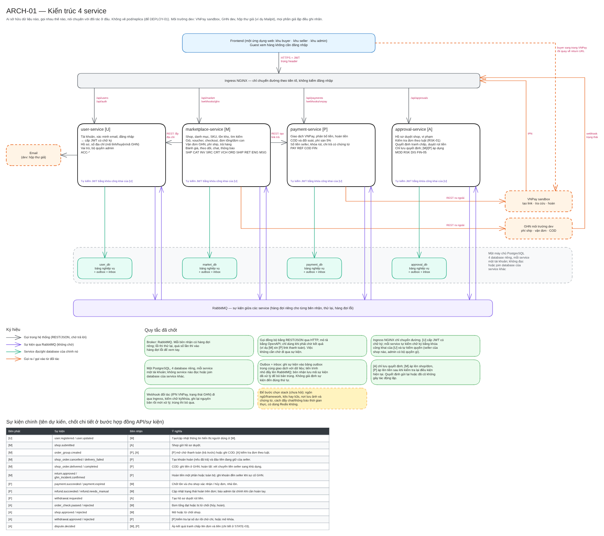

Hệ thống gồm **4 dịch vụ nghiệp vụ (backend service)** và **1 ứng dụng web**. Mỗi dịch vụ phụ trách một mảng nghiệp vụ, có cơ sở dữ liệu riêng và có thể triển khai, mở rộng độc lập.

| Dịch vụ | Phụ trách |
| --- | --- |
| **user-service** (Tài khoản) | Đăng ký, đăng nhập, cấp vé đăng nhập, hồ sơ, sổ địa chỉ, bộ quyền quản trị |
| **marketplace-service** (Sàn) | Cửa hàng, danh mục, sản phẩm, tồn kho, tìm kiếm, giỏ hàng, voucher, đặt hàng, đơn hàng, vận chuyển, trả hàng, đánh giá, chat, thông báo |
| **payment-service** (Thanh toán) | Giao dịch VNPay, phân bổ tiền, hoàn tiền, phí sàn, ví người bán, đối soát, chi trả |
| **approval-service** (Phê duyệt) | Duyệt hồ sơ shop, xử lý vi phạm, kiểm tra đơn rủi ro, phân xử khiếu nại, duyệt rút tiền |
| **Ứng dụng web** | Một ứng dụng gồm 3 khu: Mua hàng, Kênh người bán, Quản trị |

Cách chia này bám theo **người sở hữu nghiệp vụ**: ví dụ approval-service chỉ lưu quyết định duyệt (ai duyệt, lý do, lúc nào); việc áp quyết định đó lên shop hay đơn hàng do marketplace-service tự làm; việc áp lên tiền do payment-service tự làm. Nhờ vậy mỗi loại dữ liệu chỉ có một nơi được phép thay đổi.

### 3.2. Nguyên tắc dữ liệu

- Mỗi dịch vụ chỉ đọc và ghi cơ sở dữ liệu của chính mình. Cần dữ liệu của dịch vụ khác thì gọi dịch vụ đó, hoặc giữ một bản sao nhận qua sự kiện.
- Đơn hàng lưu **bản chụp** tại thời điểm đặt: giá, tên sản phẩm, địa chỉ nhận, phí vận chuyển, tỉ lệ phí sàn. Người bán sửa giá hay người mua sửa địa chỉ sau đó không làm thay đổi đơn cũ.
- Tiền luôn lưu bằng số nguyên đồng, không dùng số thập phân.
- Không xóa dữ liệu nghiệp vụ: sản phẩm thì ẩn; tiền thì ghi thêm bút toán điều chỉnh thay vì sửa số cũ.

### 3.3. Giao tiếp giữa các dịch vụ

Hệ thống dùng hai cách giao tiếp:

| Cách | Khi nào dùng | Ví dụ |
| --- | --- | --- |
| **Gọi trực tiếp (REST/JSON)** | Cần kết quả ngay để trả lời người dùng | Sàn hỏi Tài khoản sổ địa chỉ của người mua; Sàn yêu cầu Thanh toán tạo đường dẫn VNPay |
| **Sự kiện qua hàng đợi tin nhắn (RabbitMQ)** | Việc không cần chờ, hoặc nhiều dịch vụ cùng cần biết | Sàn báo "đơn đã đặt" → Thanh toán ghi nhận số tiền cần thu, Phê duyệt chạy luật kiểm tra |

Để không mất sự kiện và không xử lý trùng, hệ thống áp dụng hai cơ chế:

- **Hộp thư đi (outbox):** sự kiện được ghi vào cơ sở dữ liệu cùng lúc với dữ liệu nghiệp vụ, trong cùng một giao dịch; một tiến trình riêng đẩy sự kiện lên hàng đợi. Nếu dữ liệu lưu thành công thì sự kiện chắc chắn sẽ được gửi.
- **Hộp thư đến (inbox):** bên nhận lưu mã của mọi sự kiện đã xử lý; nhận lại cùng một sự kiện thì bỏ qua.

Các sự kiện chính hiện có: đơn đã đặt, đơn con bị hủy, kết quả kiểm tra đơn, thanh toán thành công, thanh toán hết hạn, hoàn tiền thay đổi trạng thái, hồ sơ shop được nộp/được quyết định, shop bị đình chỉ/khôi phục.

### 3.4. Sơ đồ tuần tự: đặt hàng và thanh toán

Sơ đồ dưới đây thể hiện cách các dịch vụ phối hợp trong luồng quan trọng nhất của hệ thống: người mua đặt hàng nhiều shop rồi thanh toán trả trước (UC05, UC07). Mũi tên liền nét là lời gọi trực tiếp cần chờ kết quả; mũi tên đi qua RabbitMQ là sự kiện, bên gửi không chờ bên nhận.

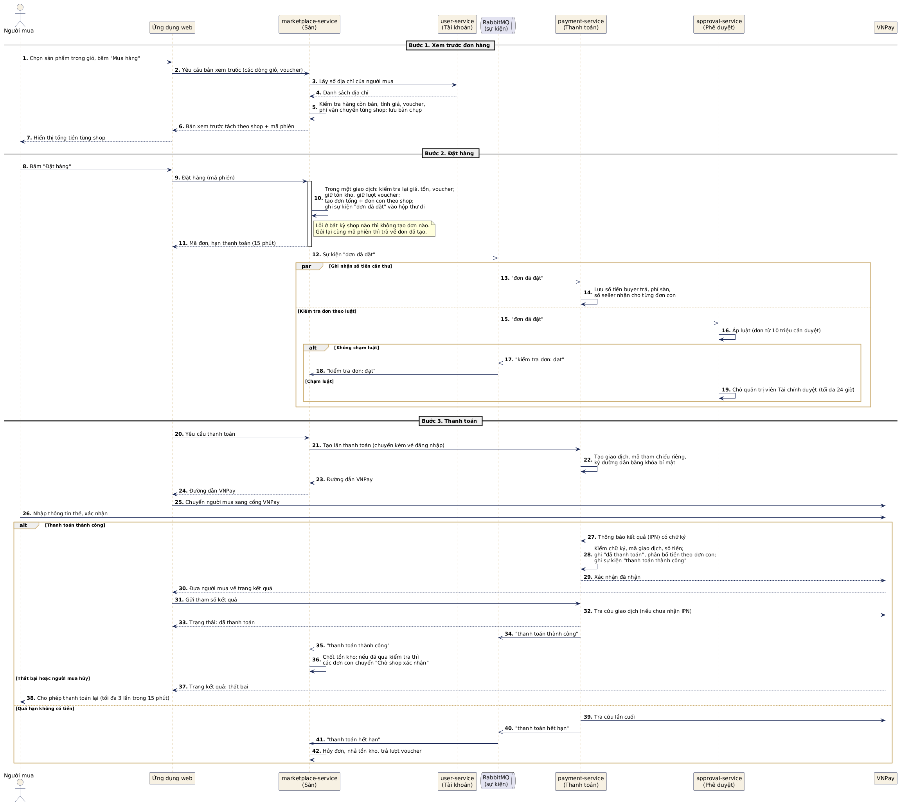

Một số điểm đáng chú ý:

- **Bước 2:** toàn bộ việc kiểm tra, giữ tồn kho, giữ voucher, tạo đơn và ghi sự kiện "đơn đã đặt" nằm trong một giao dịch cơ sở dữ liệu. Có lỗi thì không có thay đổi nào được lưu.
- **Sau bước 2:** việc ghi nhận số tiền cần thu (payment-service) và việc kiểm tra đơn theo luật (approval-service) chạy song song, không làm người mua phải chờ.
- **Bước 3:** kết quả thanh toán được xác nhận qua hai đường độc lập: VNPay gửi thông báo trực tiếp (IPN), và hệ thống tự tra cứu khi người mua quay về. Đường nào đến trước thì được ghi nhận; đường đến sau được bỏ qua vì đã có kết quả.
- Đơn chỉ chuyển cho shop xử lý khi đã đủ **cả hai** điều kiện: đã thanh toán và đã qua kiểm tra đơn.

### 3.5. Xác thực và phân quyền

- Người dùng đăng nhập tại user-service và nhận một **vé đăng nhập (JWT)** có chữ ký số, hiệu lực 15 phút, tự làm mới bằng phiên đăng nhập 7 ngày.
- Mỗi dịch vụ tự kiểm chữ ký của vé bằng khóa công khai và **tự kiểm quyền**: đúng người, đúng shop, đúng bộ quyền quản trị. Hệ thống không dựa vào việc giao diện đã ẩn nút.
- Đăng nhập sai 5 lần thì khóa 15 phút; mật khẩu chỉ lưu dạng băm.

### 3.6. Tích hợp đối tác

| Đối tác | Dùng cho | Môi trường |
| --- | --- | --- |
| VNPay | Thanh toán trả trước, tra cứu giao dịch, hoàn tiền | Sandbox (thử nghiệm). Khi chưa có tài khoản sandbox, hệ thống dùng một cổng **mô phỏng** được ghi nhãn rõ trên giao diện |
| GHN | Danh sách tỉnh/huyện/xã, tính phí vận chuyển, tạo vận đơn, nhận trạng thái giao hàng, đối soát COD | Môi trường dev của GHN; phần GHN chưa hỗ trợ thì mô phỏng và ghi rõ |
| Google | Đăng nhập bằng tài khoản Google | OAuth |
| Gmail SMTP | Gửi mã xác minh email | Khi phát triển dùng hộp thư giả |

Mọi đối tác đều được tích hợp qua một lớp trung gian (adapter), nên chuyển từ mô phỏng sang thật, hoặc thay đối tác khác, không ảnh hưởng tới nghiệp vụ.

### 3.7. Thiết kế dữ liệu tổng quan

Toàn hệ thống có khoảng 60 bảng, chia cho 4 cơ sở dữ liệu. Mỗi cơ sở dữ liệu có thêm 3 bảng kỹ thuật dùng chung cấu trúc: nhật ký thao tác quản trị, hộp thư đi, hộp thư đến.

| Cơ sở dữ liệu | Các bảng chính |
| --- | --- |
| Tài khoản | Người dùng, mã xác minh, phiên đăng nhập, sổ địa chỉ |
| Sàn | Tỉnh/huyện/xã; shop, hồ sơ mở shop; danh mục, sản phẩm, phân loại, ảnh, lịch sử tồn kho; giỏ hàng, voucher, lượt dùng voucher; phiên đặt hàng, đơn tổng, đơn con, dòng hàng, lịch sử đơn; vận đơn; trả hàng; đánh giá, theo dõi; chat, thông báo; cấu hình |
| Thanh toán | Lần thanh toán, khoản hoàn, tiền người bán theo đơn, ví người bán, lịch sử ví, yêu cầu rút tiền, đối soát COD, cấu hình |
| Phê duyệt | Hồ sơ duyệt shop, vi phạm, kiểm tra đơn, khiếu nại, duyệt rút tiền, cấu hình |

Sơ đồ chi tiết từng cơ sở dữ liệu: xem Phụ lục B (sơ đồ 09–12).

---

## 4. Công nghệ sử dụng

| Lớp | Công nghệ | Lý do lựa chọn |
| --- | --- | --- |
| Ngôn ngữ | TypeScript trên Node.js 22 | Một ngôn ngữ cho cả backend và frontend; kiểu dữ liệu chặt giúp giảm lỗi khi nhiều dịch vụ trao đổi dữ liệu |
| Backend | NestJS 11 | Khung chuẩn cho dịch vụ Node.js: chia module rõ ràng, có sẵn kiểm tra dữ liệu đầu vào, tự sinh tài liệu API (Swagger) |
| Truy cập dữ liệu | Prisma 6 | Định nghĩa bảng và tạo migration có kiểm soát phiên bản cho từng dịch vụ |
| Cơ sở dữ liệu | PostgreSQL 16 | Giao dịch tin cậy (quan trọng với tiền và tồn kho); tìm kiếm toàn văn có hỗ trợ bỏ dấu tiếng Việt |
| Hàng đợi tin nhắn | RabbitMQ | Chuyển sự kiện giữa các dịch vụ, có cơ chế thử lại và hàng đợi lỗi |
| Lưu file | MinIO | Lưu ảnh sản phẩm, bằng chứng, biên lai theo chuẩn S3 |
| Thời gian thực | Socket.IO + Redis | Chat và thông báo tức thời, hoạt động đúng khi chạy nhiều bản dịch vụ |
| Việc hẹn giờ | pg-boss | Chạy các việc như hủy đơn quá hạn, tra cứu thanh toán, đối soát; nhiều bản dịch vụ vẫn chỉ một bản thực hiện mỗi việc |
| Frontend | React 19, Vite, Tailwind CSS 4, shadcn/ui | Hệ sinh thái phổ biến, giao diện dùng được trên cả máy tính và điện thoại |
| Đóng gói | Docker, Docker Compose | Chạy toàn bộ hạ tầng và hệ thống bằng một lệnh |
| Triển khai | Kubernetes (k3s), Ingress NGINX | Chạy nhiều bản mỗi dịch vụ, tự khởi động lại khi lỗi; k3s nhẹ, phù hợp máy cá nhân |
| Kiểm thử, tích hợp liên tục | Jest, GitHub Actions | Kiểm thử tự động cho mọi thay đổi trước khi gộp vào nhánh chính |
| Quản lý mã nguồn | pnpm workspaces (monorepo), Git/GitHub | Một kho chứa cả 4 dịch vụ, ứng dụng web và các gói dùng chung |

---

## 5. Hạ tầng và triển khai

### 5.1. Mô hình triển khai

```
                    Người dùng (trình duyệt)          VNPay, GHN (gửi kết quả về)
                               │                                │
                               ▼                                ▼
                 ┌──────────────────────────────────────────────────────┐
                 │        Ingress NGINX: chuyển yêu cầu theo đường dẫn    │
                 └──────────────────────────────────────────────────────┘
                   │            │               │               │          │
                   ▼            ▼               ▼               ▼          ▼
              Ứng dụng web  user-service  marketplace-service  payment-  approval-
                                                               service   service
                                  │               │               │          │
                 ┌────────────────┴───────────────┴───────────────┴──────────┘
                 ▼                  ▼                   ▼              ▼
          PostgreSQL           RabbitMQ              MinIO           Redis
       (4 cơ sở dữ liệu)   (sự kiện giữa         (ảnh, biên lai)  (chat, thông
                            các dịch vụ)                           báo thời gian thực)
```

- **Ingress NGINX** là cổng vào duy nhất, chỉ chuyển yêu cầu tới đúng dịch vụ theo đường dẫn (ví dụ `/api/payment/...` tới payment-service); việc kiểm tra đăng nhập do từng dịch vụ tự làm.
- **PostgreSQL** chạy một máy chủ chứa 4 cơ sở dữ liệu tách biệt; mỗi dịch vụ dùng một tài khoản riêng, không truy cập được cơ sở dữ liệu của dịch vụ khác.
- Các dịch vụ **không lưu trạng thái trên máy chạy** (mọi dữ liệu nằm trong cơ sở dữ liệu, hàng đợi hoặc kho file), nên có thể chạy nhiều bản song song và thay thế bản bị lỗi mà không mất dữ liệu.

### 5.2. Các môi trường

| Môi trường | Cách chạy | Mục đích |
| --- | --- | --- |
| Phát triển | Hạ tầng (PostgreSQL, RabbitMQ, Redis, MinIO, hộp thư giả) chạy bằng Docker Compose; các dịch vụ chạy trực tiếp trên máy lập trình viên | Lập trình và kiểm thử hằng ngày |
| Chạy thử toàn hệ thống | Toàn bộ dịch vụ và ứng dụng web chạy trong Docker bằng một lệnh | Kiểm tra trước khi demo |
| Demo | Kubernetes (k3s) trên máy cá nhân, mỗi dịch vụ chạy nhiều bản | Trình diễn khả năng chịu lỗi: tắt một bản dịch vụ, hệ thống vẫn phục vụ và dữ liệu không mất |

### 5.3. Việc chạy nền theo lịch

Một số nghiệp vụ không do người dùng kích hoạt mà chạy theo thời gian:

| Việc | Tần suất |
| --- | --- |
| Hủy đơn quá hạn thanh toán, nhả tồn kho | Mỗi phút |
| Hủy đơn shop không xác nhận/không bàn giao đúng hạn | Mỗi phút |
| Hủy đơn quá hạn duyệt | Mỗi phút |
| Tra cứu VNPay các giao dịch chưa rõ kết quả | Mỗi phút |
| Gửi và thử lại lệnh hoàn tiền | Mỗi phút |
| Hoàn tất đơn sau 7 ngày, chuyển tiền người bán sang khả dụng | Theo lịch (P4) |
| Đối soát giao dịch VNPay | Hằng ngày (P4) |
| Cập nhật danh sách tỉnh/huyện/xã từ GHN | Hằng ngày |

Mọi việc đều được thiết kế để chạy lại nhiều lần mà không gây tác động trùng (ví dụ không hủy một đơn hai lần, không hoàn tiền hai lần).

### 5.4. Kiểm thử và quy trình làm việc nhóm

- Mỗi chức năng được làm trên một nhánh riêng, gộp vào nhánh chính qua yêu cầu gộp mã (Pull Request) có ít nhất một thành viên duyệt.
- Hệ thống tích hợp liên tục tự chạy kiểm tra định dạng mã, kiểm tra kiểu dữ liệu, kiểm thử tự động và đóng gói cho mọi thay đổi.
- Các nghiệp vụ liên quan tới tiền, trạng thái đơn và phân quyền bắt buộc có kiểm thử tự động. Đến hết giai đoạn P3, hệ thống có hơn 300 ca kiểm thử tự động.

---

## 6. Tiến độ thực hiện

### 6.1. Phương pháp thực hiện

Nhóm làm theo hình thức **cuốn chiếu theo giai đoạn**. Phân tích tổng thể (phạm vi, luồng nghiệp vụ, vòng đời trạng thái, kiến trúc) được hoàn thành trước cho toàn bộ dự án. Sau đó, với mỗi giai đoạn:

1. Chốt các quy tắc nghiệp vụ còn mở của giai đoạn đó.
2. Thiết kế chi tiết: giao diện lập trình (API), sự kiện, bảng dữ liệu.
3. Lập trình kèm kiểm thử tự động.
4. Chạy thử, demo, rồi chuyển sang giai đoạn tiếp theo.

Mọi quyết định nghiệp vụ đều được ghi lại thành tài liệu kèm ngày chốt, để cả nhóm làm thống nhất.

### 6.2. Các giai đoạn

| Giai đoạn | Nội dung | Kết quả kiểm chứng | Trạng thái |
| --- | --- | --- | --- |
| **P0. Thiết kế** | Phạm vi, quy tắc nghiệp vụ, sơ đồ luồng và trạng thái, kiến trúc, dữ liệu, giao tiếp giữa dịch vụ | Bộ tài liệu, sơ đồ use case, luồng, trạng thái, tuần tự, kiến trúc, dữ liệu | Hoàn thành |
| **P1. Tài khoản và cửa hàng** | Nền tảng chung, đăng ký/đăng nhập, phân quyền, hồ sơ, sổ địa chỉ, mở shop có duyệt, nhật ký quản trị | Đăng ký → mở shop → quản trị viên khác duyệt → người bán chỉ quản lý được shop của mình | Hoàn thành |
| **P2. Sản phẩm và giỏ hàng** | Danh mục, sản phẩm có phân loại, tồn kho, tìm kiếm, giỏ hàng nhiều shop, tạo voucher, đình chỉ shop | Hai shop có hàng; người mua tìm và thêm hàng của cả hai vào giỏ | Hoàn thành |
| **P3. Đặt hàng và trả trước** | Đặt hàng nhiều shop, áp voucher, phí vận chuyển, giữ tồn kho, thanh toán VNPay, kiểm tra đơn, xác nhận/hủy đơn, hoàn tiền, cấu hình chính sách | Một lần đặt → hai đơn con → thanh toán → hủy một đơn con không ảnh hưởng đơn còn lại | Hoàn thành |
| **P4. Giao hàng và đối soát** | Vận đơn GHN, bàn giao, giao thất bại, hoàn kiện, COD, đối soát COD, ví người bán, hoàn tất đơn | Theo dõi đủ hàng và tiền; tiền COD chưa đối soát không được coi là đã về sàn | Hoàn thành |
| **P5. Hậu mãi và rút tiền** | Trả hàng, khiếu nại, hoàn tiền một phần, giữ tiền khi có khiếu nại, rút tiền, chi trả, điều chỉnh ví sau giải ngân | Một yêu cầu trả hàng chạy tới kết thúc; một yêu cầu rút tiền có nguồn tiền, quyết định và chứng từ rõ ràng | Hoàn thành |
| **P6. Tương tác và hoàn thiện** | Chat, thông báo, đánh giá, theo dõi shop, báo cáo, tối ưu tìm kiếm, kiểm thử tổng hợp | Người mua, người bán, quản trị viên dùng được trọn vòng đời | Kế hoạch |
| **Triển khai** | Đưa toàn bộ hệ thống lên Kubernetes (k3s) | Demo khả năng chịu lỗi và đúng nghiệp vụ khi chạy nhiều bản | Kế hoạch, trước buổi demo |

### 6.3. Kết quả đã đạt được

- Hoàn thành bộ tài liệu phân tích: phạm vi, danh mục chức năng, quy tắc nghiệp vụ, bộ sơ đồ (use case, luồng nghiệp vụ, vòng đời trạng thái, tuần tự, kiến trúc, dữ liệu, giao diện; xem Phụ lục B).
- Hoàn thành nền tảng kỹ thuật chung cho 4 dịch vụ: xác thực, phân quyền, xử lý lỗi, gửi/nhận sự kiện, nhật ký quản trị, việc hẹn giờ, cấu hình có phiên bản.
- Hoàn thành 5 giai đoạn chức năng P1–P5. Người mua đã có thể đi từ đăng ký, tìm hàng, đặt hàng nhiều shop, thanh toán (trả trước hoặc COD), theo dõi giao hàng, tới hủy, trả hàng, khiếu nại và nhận hoàn tiền. Người bán đã có thể mở shop, đăng hàng, quản lý tồn kho, voucher, xử lý và giao đơn, xử lý yêu cầu trả hàng, xem ví và rút tiền. Quản trị viên đã có thể duyệt shop, đình chỉ shop, duyệt đơn rủi ro, phân xử tranh chấp, đối soát COD và VNPay, duyệt và chi trả rút tiền, điều chỉnh ví có hai người duyệt, và cấu hình chính sách.
- Cổng thanh toán và vận chuyển chạy được ở cả chế độ mô phỏng (có ghi nhãn rõ) lẫn môi trường thử nghiệm của đối tác, đổi qua lại bằng cấu hình.
- Hệ thống chạy được toàn bộ bằng Docker; hơn 400 ca kiểm thử tự động.

### 6.4. Kế hoạch tiếp theo

1. Chốt quy tắc và triển khai P6 (chat, thông báo, đánh giá, theo dõi shop, báo cáo, tối ưu tìm kiếm).
2. Kiểm thử tổng hợp theo các kịch bản nghiệm thu toàn sàn.
3. Nối tài khoản thật VNPay sandbox và GHN môi trường thử nghiệm.
4. Đưa hệ thống lên Kubernetes, chuẩn bị kịch bản demo nghiệm thu.

---

## 7. Khó khăn, rủi ro và đề xuất

### 7.1. Khó khăn và rủi ro

| Vấn đề | Ảnh hưởng | Hướng xử lý |
| --- | --- | --- |
| Chưa có tài khoản VNPay sandbox và GHN dev | Chưa kiểm chứng được tích hợp thật | Dùng cổng mô phỏng có ghi nhãn; đăng ký tài khoản thử nghiệm để chuyển sang thật trước buổi demo |
| VNPay và GHN chỉ gửi kết quả tới địa chỉ công khai trên Internet | Máy cá nhân không nhận được kết quả | Dùng đường hầm (cloudflared) để có địa chỉ công khai; bổ sung cơ chế tự tra cứu khi không nhận được |
| Khối lượng P6 (chat thời gian thực chạy nhiều bản, thông báo, báo cáo) | Nguy cơ trễ tiến độ | Ưu tiên luồng chính trước, các nhánh ngoại lệ sau; mỗi giai đoạn đều có kết quả demo được |
| Luồng tiền P3–P5 phức tạp (hoàn một phần, giữ tiền khi trả hàng, rút tiền) | Sai một chỗ là lệch số dư người bán | Kiểm thử tự động cho mọi phép tính tiền và trạng thái; số dư ví luôn bằng tổng các dòng biến động |
| Tài nguyên máy cá nhân (24 GB RAM) cho Kubernetes | Khó chạy nhiều bản mỗi dịch vụ cùng hạ tầng | Dùng k3s (bản Kubernetes nhẹ), giới hạn tài nguyên từng dịch vụ |

### 7.2. Đề xuất xin ý kiến giảng viên

1. Phạm vi hiện tại (đủ vòng đời mua, bán, vận hành) có phù hợp với yêu cầu đồ án không, hay nên thu hẹp để tập trung chiều sâu?
2. Nếu thiếu thời gian ở P6, nhóm nên ưu tiên phần nào: chat thời gian thực, thông báo, đánh giá hay báo cáo thống kê?
3. Việc dùng cổng thanh toán và vận chuyển mô phỏng (có ghi nhãn rõ) trong buổi demo có được chấp nhận nếu chưa kịp có tài khoản thử nghiệm của đối tác không?
4. Mức độ yêu cầu với phần triển khai Kubernetes: chỉ cần chạy được, hay cần trình diễn khả năng chịu lỗi và mở rộng?

---

## Phụ lục A. Bảng thuật ngữ

| Thuật ngữ | Giải thích |
| --- | --- |
| Sàn nhiều người bán (marketplace) | Nền tảng nơi nhiều cửa hàng độc lập cùng bán hàng; sàn quản lý giao dịch và tiền |
| Đơn tổng | Một lần đặt hàng của người mua, có thể gồm hàng của nhiều shop |
| Đơn con | Phần của một shop trong đơn tổng; mỗi đơn con được xử lý, giao và hoàn tất độc lập |
| Trả trước | Thanh toán trực tuyến trước khi giao hàng |
| COD | Thanh toán khi nhận hàng (Cash On Delivery); đơn vị vận chuyển thu hộ tiền |
| Đối soát | So khớp số liệu tiền của sàn với số liệu của đối tác (VNPay, GHN) |
| Hoàn kiện | Hàng giao không thành công được đơn vị vận chuyển gửi trả về shop |
| Phí sàn | Phần trăm sàn thu trên doanh thu của người bán |
| Voucher | Mã giảm giá; voucher của shop do shop chịu, voucher của sàn do sàn chịu |
| Vận đơn | Đơn gửi hàng tạo trên hệ thống của đơn vị vận chuyển |
| Microservices | Kiến trúc chia hệ thống thành nhiều dịch vụ nhỏ, độc lập, giao tiếp với nhau qua mạng |
| REST/JSON | Cách các dịch vụ gọi nhau qua giao thức HTTP, dữ liệu dạng JSON |
| Hàng đợi tin nhắn | Trung gian nhận và chuyển sự kiện giữa các dịch vụ (ở đây là RabbitMQ) |
| JWT | Vé đăng nhập có chữ ký số; dịch vụ kiểm chữ ký để biết người gọi là ai và có quyền gì |
| IPN | Thông báo kết quả thanh toán mà VNPay gửi trực tiếp tới máy chủ của sàn |
| Sandbox | Môi trường thử nghiệm của đối tác, không phát sinh tiền thật |
| Outbox / Inbox | Cơ chế bảo đảm sự kiện không bị mất khi gửi và không bị xử lý trùng khi nhận |
| Kubernetes, k3s | Nền tảng điều phối chạy nhiều bản dịch vụ, tự khởi động lại khi lỗi; k3s là bản rút gọn |
| Docker | Công cụ đóng gói ứng dụng cùng môi trường chạy để chạy giống nhau ở mọi máy |
| Migration | Một bước thay đổi cấu trúc cơ sở dữ liệu có đánh số phiên bản |

## Phụ lục B. Danh mục sơ đồ

Các sơ đồ nằm trong thư mục `docs/so-do`. Sơ đồ 01–13 vẽ bằng Excalidraw (bản `.png` để xem, bản `.excalidraw` để chỉnh sửa); sơ đồ 14–16 viết bằng PlantUML (mã nguồn trong `docs/so-do/plantuml`, xuất ra `.png`).

| Số | Sơ đồ | Nội dung |
| --- | --- | --- |
| 01 | Bản đồ chức năng | Toàn bộ chức năng theo người dùng và nhóm nghiệp vụ |
| 02 | Đặt hàng nhiều shop | Từ giỏ hàng tới tạo đơn tổng và các đơn con |
| 03 | Thanh toán trả trước và kiểm tra đơn | Hai nhánh song song, các trường hợp lỗi và quá hạn |
| 04 | Vòng đời đơn con và vận đơn | Các trạng thái, điều kiện chuyển, nhánh hủy và giao thất bại |
| 05 | Thanh toán, hoàn tiền, tiền người bán | Vòng đời của tiền từ khi thu tới khi chi trả |
| 06 | Kiến trúc 4 dịch vụ | Dịch vụ, cơ sở dữ liệu, hàng đợi, đối tác và cách giao tiếp |
| 07 | Khung giao diện chung | Bố cục 3 khu: mua hàng, người bán, quản trị |
| 08 | Đăng ký và mở shop | Luồng tài khoản và duyệt hồ sơ shop |
| 09–12 | Dữ liệu từng dịch vụ | Các bảng và quan hệ của 4 cơ sở dữ liệu |
| 13 | Màn hình giai đoạn P1 | Khung các màn hình tài khoản, shop, quản trị |
| 14 | Use case tổng quát | Các nhóm chức năng lớn và tác nhân |
| 14a–14c | Use case phân rã | Use case chi tiết của người mua, người bán, quản trị viên |
| 15 | Tuần tự: đặt hàng và thanh toán | Phối hợp giữa các dịch vụ, RabbitMQ và VNPay trong luồng đặt hàng, thanh toán |
| 16 | Vòng đời yêu cầu trả hàng và tranh chấp | Các trạng thái, thời hạn, tự chấp nhận/tự hoàn khi quá hạn, nhánh khiếu nại và phân xử |
